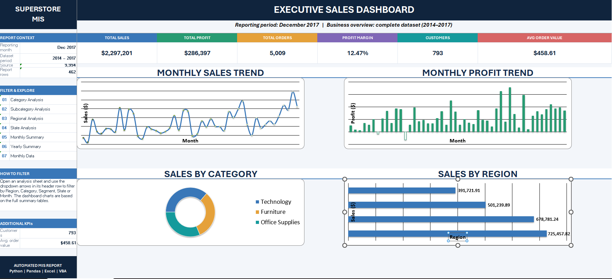

# Excel Report Automation — Superstore MIS Dashboard

A one-command Python pipeline that transforms raw Superstore sales data (CSV) into a professionally formatted, 8-sheet Excel MIS workbook with an executive dashboard. The project also includes a VBA control panel and a Windows Task Scheduler setup for repeatable monthly report generation.

## The Problem

Monthly MIS reporting often involves repetitive manual work: loading data, cleaning records, building summaries, creating charts, formatting workbooks, and repeating the process for each reporting cycle. This project uses an estimated manual baseline of **3.5 analyst-hours per cycle**. Manual processes can also introduce copy-paste errors, formula inconsistencies, and variations in report formatting.

## What This Project Does

- Loads and validates **9,994 Superstore sales records** covering 2014–2017.
- Cleans and prepares the data, including handling missing values, duplicates, and invalid dates.
- Calculates business KPIs: sales, profit, profit margin, order volume, and average order value (AOV).
- Produces category, subcategory, regional, state, monthly, and yearly analysis.
- Generates an Excel workbook with **8 worksheets, 6 KPI cards, 4 charts, conditional formatting, AutoFilters, and print-ready layouts**.
- Detects the latest reporting month available in the input dataset.
- Includes a VBA control panel for selecting a reporting month and launching report generation.
- Supports scheduled execution through Windows Task Scheduler.

## Project Impact

| Metric | Manual process | Automated pipeline |
|---|---:|---:|
| Time per report | Approximately 3.5 hours (estimated) | 2.71 seconds (measured) |
| Workbook structure | Manually prepared | 8 consistent worksheets |
| Repeated calculations | Manual / spreadsheet-based | Automated Python calculations |

**Measurement notes:** The manual baseline of 3.5 hours (210 minutes) is an estimate, not a stopwatch-verified measurement of a company's process. The automated runtime of **2.71 seconds** was measured on the development machine during a successful run of `python run_monthly_report.py`. Actual runtime can vary with hardware, data size, and workload.

Using these figures, the estimated elapsed time saved is approximately **209.95 minutes per run**, equivalent to an estimated **99.98% reduction in report-generation elapsed time**. This is a project-level comparison, not a guarantee of business-wide productivity savings; review, interpretation, and distribution may still require human effort.

To measure runtime on your own machine, run this command in PowerShell from the project directory:

```powershell
Measure-Command { python run_monthly_report.py }
```

## How It Works

```text
Superstore CSV
     |
     v
Data Loading (Pandas: schema checks and date parsing)
     |
     v
Cleaning and Validation (missing values, duplicates, invalid dates)
     |
     v
Transformation (Year, Month, and Year-Month dimensions)
     |
     v
Business Metrics (KPIs and category / region / state / time breakdowns)
     |
     v
Excel Generation (OpenPyXL: 8 worksheets, KPI cards, charts, formatting)
     |
     v
Superstore_MIS_YYYY-MM.xlsx  -->  reports/
```

### Three Automation Options

1. **Python entry point:** Run `run_monthly_report.py` to detect the latest month available in the dataset and generate the report.
2. **VBA control panel:** Use the Excel macro-enabled workbook to select a reporting month in `MIS Control Panel!B8` and launch the Python report-generation process.
3. **Windows Task Scheduler:** Run the Python entry point automatically on the configured monthly schedule.

> **Important:** The scheduler runs the report-generation script; it does not fetch new Superstore data. The input CSV must be updated separately for the report to include newly available transactions. If the CSV remains unchanged, the script will continue to detect the same latest month.

## Workbook Contents

| Worksheet | Description |
|---|---|
| Executive Dashboard | 6 KPI cards, monthly sales and profit trends, category and regional charts |
| Category Analysis | Furniture, Technology, and Office Supplies performance |
| Subcategory Analysis | Subcategory-level sales and profit analysis |
| Regional Analysis | West, East, Central, and South comparison |
| State Analysis | State-wise sales, profit, and profitability |
| Monthly Summary | Month-wise sales and profit trends |
| Yearly Summary | Annual performance for 2014–2017 |
| Monthly Data | Transaction-level detail for the selected reporting month |

**Reporting scope:** Executive Dashboard KPIs and the category, subcategory, regional, state, monthly, and yearly summaries cover the full dataset period (2014–2017). The **Monthly Data** worksheet is scoped to the selected reporting month.

### Executive Dashboard Preview



## Quickstart

### 1. Clone the repository

```bash
git clone https://github.com/satyam-katara/excel-report-automation.git
cd excel-report-automation
```

### 2. Create and activate a virtual environment (Windows PowerShell)

```powershell
python -m venv .venv
.venv\Scripts\Activate.ps1
```

If PowerShell blocks script activation, you can activate the environment from Command Prompt instead:

```cmd
.venv\Scripts\activate.bat
```

### 3. Install dependencies

```bash
pip install -r requirements.txt
```

### 4. Generate the report

```bash
python run_monthly_report.py
```

The generated workbook is saved in the `reports/` directory. The filename follows the pattern `Superstore_MIS_YYYY-MM.xlsx`.

## Scheduling

The project has been configured with the following Windows Task Scheduler settings:

| Setting | Value |
|---|---|
| Task name | Superstore Monthly MIS Automation |
| Trigger | Monthly, on the 1st day at 8:00 AM |
| Script | `run_monthly_report.py` |
| Reporting month | Automatically detected from the latest month in the input data |

The computer must be powered on (or configured to wake for the task), and the task must be enabled. Ensure the task uses the project's Python virtual environment and the correct project working directory. The input CSV must also be refreshed separately when new data becomes available.

## VBA Integration

The `vba/` directory contains the VBA source module and macro-enabled Excel workbook:

- `GenerateReport.bas` — VBA macro source.
- `Superstore_MIS_Automation.xlsm` — macro-enabled control panel workbook.

The control panel uses `MIS Control Panel!B8` as the reporting-month input and invokes the Python report-generation process. Python and the project dependencies must be installed on the machine running the macro.

## Tests

Run the test suite from the project root:

```bash
pytest -v
```

The project test suite contains **6 tests** covering the data loader, cleaning logic, and report metrics. Run the command locally to confirm the current test status before publishing changes.

## Project Structure

```text
excel-report-automation/
├── Data/
│   └── Sample - Superstore.csv
├── logs/
├── reports/                         # Generated workbooks (git-ignored)
├── screenshots/
│   └── executive_dashboard.png
├── src/
│   ├── main.py                      # Pipeline orchestration
│   ├── data_loader.py               # CSV loading, schema and date checks
│   ├── data_cleaning.py              # Cleaning and validation
│   ├── report_metrics.py             # KPI and breakdown calculations
│   ├── excel_formatter.py            # Workbook, dashboard, charts and formatting
│   └── inspect_data.ipynb             # Data exploration notebook
├── tests/                            # Pytest suite
├── vba/
│   ├── GenerateReport.bas             # Control-panel macro source
│   └── Superstore_MIS_Automation.xlsm
├── run_monthly_report.py              # Month-aware entry point
├── requirements.txt
├── .gitignore
└── README.md
```

## Technology Stack

- **Language:** Python
- **Data processing:** Pandas, NumPy
- **Excel generation:** OpenPyXL
- **Visualization:** Matplotlib, Seaborn
- **Excel automation:** VBA
- **Scheduling:** Windows Task Scheduler
- **Testing:** Pytest

## Possible Future Enhancements

- Automated email distribution of generated reports.
- Budget-versus-actual analysis when budget data is available.
- Native Excel slicers for interactive dashboard filtering.
- Automated ingestion of refreshed source data.

## Author

**Satyam Katara**  
B.Tech, Computer Science and Engineering (Data Science), 2027  
[GitHub Profile](https://github.com/satyam-katara)
